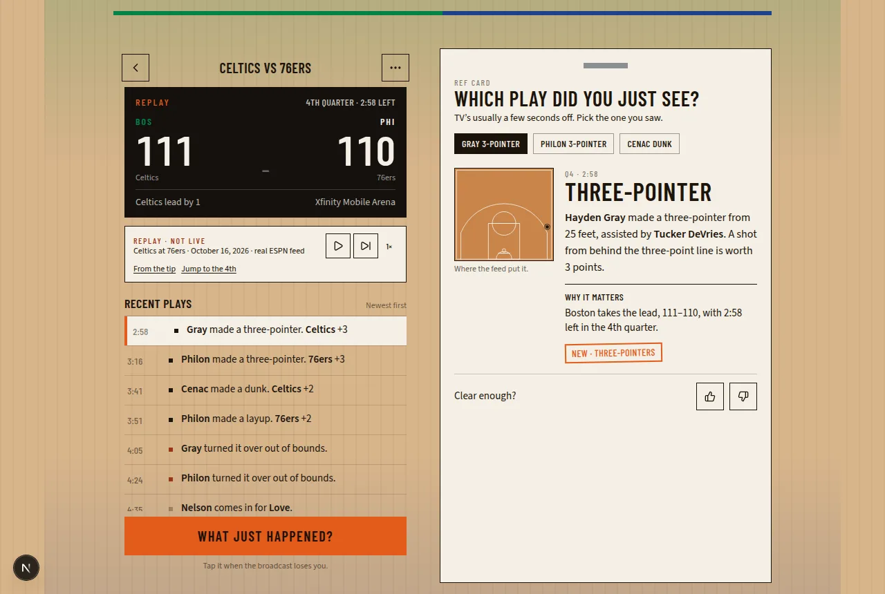

# Whistle

NBA, in plain English.

Whistle is a live companion for people who do not know the rules yet. Open a game, and when the broadcast loses you, tap **What just happened?** It explains the play you just saw: who did it, what the rule is, and why it matters in this game.



## What it does

- **Today's games.** The home screen reads the public ESPN NBA scoreboard. Live games are marked, pregame games show the tip time with no fake 0–0, and an empty day says so.
- **Live game.** The scoreboard, a plain-English play list, and the orange button. While a game is in progress the page polls every 5 seconds and pauses when the tab is hidden.
- **What just happened?** The last three plays are chips, because a TV is often a few seconds off the feed. You pick the one you saw. The card names the rule, fills in the players, score, and clock from the feed, and adds a "Why it matters" line from the game state.
- **Replay.** If nothing is live, a recorded real game still plays. It is the Celtics at the 76ers on October 16, 2026 (ESPN event `401898407`), overtime, 125–120, at Xfinity Mobile Arena. The screen says **REPLAY · NOT LIVE**. It is not a simulated score.
- **Rules learned.** Opening an explanation marks that rule in this browser. Scrolling past a play does not. The Rules page shows progress.
- **Stats.** Thumbs up or down on an explanation, plus how long the template took. Clear rating and median time are computed from those samples. A dash means there is no sample. Nothing is seeded.

Whistle is not affiliated with the NBA or ESPN.

## Architecture

```text
browser  --poll-->  /api/scoreboard, /api/game/[id]  -->  ESPN public JSON
   |                         |
   |                         +-- demo route serves a stripped copy of one real game
   |
   +-- explain.ts   templates + running foul/score context  (no API key)
   |
   +-- /api/rephrase   optional, only if LLM_API_KEY is set, then guardrailed
   |
   +-- localStorage   rules, votes, latencies. Never sent anywhere.
```

The browser never calls ESPN directly. The two route handlers proxy the scoreboard and the summary feed, reject any game id that is not a short number, and send `cache: no-store`. That is what makes it deployable on Vercel without a CORS workaround in the client.

| Piece | Where |
| --- | --- |
| Play types and rule lessons | `src/lib/rules.ts` |
| Parser, foul counts, "why it matters" | `src/lib/explain.ts` |
| Rephrase allow-list | `src/lib/guardrail.ts` |
| ESPN normalization | `src/lib/espn.ts` |
| Replay projection | `src/lib/demo.ts`, `src/data/demo-game.json` |
| Votes, latency, rules | `src/lib/persist.ts` |
| Clear rating and median | `src/lib/metrics.ts` |

Stack: Next.js (App Router), React, TypeScript, Tailwind CSS. No database and no account.

## How explanations are generated

Every explanation is a template. The parser reads the ESPN play text and type (`shot`, `foul`, `turnover`, `rebound`, and so on) and fills names, the clock, and the score that the feed says were true *after* that play.

The catalog covers shooting fouls and non-shooting fouls, and-ones, free throws, twos and threes, blocks, steals, turnovers, travels, shot-clock violations, offensive fouls, loose-ball fouls, technicals, flagrants, goaltending, jump balls, timeouts, substitutions, challenges, lane violations, kicked balls, defensive three seconds, and the end of a period or game.

A few things the feed does not spell out are counted as the game is replayed, because ESPN does not put them in the play text:

- Team fouls reset each quarter. Offensive fouls count on the player and not on the team. Team foul 5 is the bonus.
- A player is in foul trouble at 5 and fouls out at 6, across quarters.
- An and-one is a made basket and a shooting foul at the same clock.
- A scoring run and a lead change come from the score on successive plays.

"Why it matters" uses that context, in a fixed order: the game or period ending, a lead change, a close game with free throws late, foul-out, the bonus, a run, a late timeout, then the score itself. The late free-throw line is specific on purpose. Down 2 with 1:10 left and three free throws coming, it says the shooter can take the lead if they make all three. It does not invent the contact. "Foul on Tatum" stays a foul. It does not become "hit his arm."

No key is required. This path is what `npm test` locks in, including every play of the recorded Celtics–76ers game.

## The no-hallucination guardrail

Templates are the product. An optional rephrase exists only to vary the wording.

If `LLM_API_KEY` is set, the browser sends the explanation's fact object to `POST /api/rephrase`. The prompt tells the model to use only those facts, forbids guesses, and asks for JSON at temperature 0. The server then checks the reply, and the browser checks it again:

- Any number that is not already in the facts or the written rule is rejected.
- Any capitalized token that is not a known player, team, rule word, or ordinary sentence word is rejected.
- Hedge words (`probably`, `maybe`, `I think`, and similar) are rejected.

A rejected reply is thrown away. The template stays on screen, with a line that says the rephrase was discarded. Accepted rephrases are timed separately and are not mixed into the template median. With no key, the button is not shown a rephrase at all.

## Feed delay vs the TV

Whistle does not guess how far behind your television is. Broadcasts, streams, and the arena feed all drift, and a guessed offset would explain the wrong play with confidence.

The button opens the last three non-substitution plays. You tap the one that matches the screen. Older rows in the list open too, if the delay was longer than three plays.

Feed lag is a different number, and only for a live game: the ESPN wallclock on the play versus when that play reached this browser. Replay timestamps are days old, so they are excluded. Anything older than 10 minutes is excluded too, so a stale clock cannot dominate the median.

## Metrics

Stats are resume numbers, so they are whatever this browser actually recorded.

- **Clear rating** is thumbs-up divided by votes. One vote per play; a later vote replaces the earlier one. No votes is an em dash, not 0%. Zero percent would mean every vote was thumbs-down.
- **Time to explanation** is the time from a play arriving in the browser until the template pass that included it finished. Plays that show up in the same update share that duration. The median is the middle of those samples.
- **Feed lag** is the live-only figure above.
- **LLM time** appears only after an accepted rephrase, and it is not folded into the template median.

Samples live in `localStorage` (`whistle.feedback.v1`, `whistle.latency.v1`, `whistle.rules.v1`), capped at 1,000 votes and 2,000 timings, oldest dropped. Reset is on the Stats page. Nothing is uploaded.

## Run it

```bash
npm install
npm test
npm run dev
```

The dev server is [http://127.0.0.1:4317](http://127.0.0.1:4317). Open **Watch** on the replay if nothing is live.

`npm test` runs Vitest over the explanation engine: the late shooting-foul case, and-ones, the bonus, foul trouble, the common play types, lead changes, the guardrail, the median, and all 564 plays of the recorded game.

`npm run build` is the production build. `npm start` serves that build on port 4317.

## Deploy

[Vercel](https://vercel.com) with no required environment variables. The scoreboard proxy and the replay are enough.

Optional, only for the rephrase:

| Variable | Purpose |
| --- | --- |
| `LLM_API_KEY` | Turns the rephrase on. Omit it and Whistle stays templates-only. |
| `LLM_BASE_URL` | OpenAI-compatible base URL. Defaults to `https://api.openai.com/v1`. |
| `LLM_MODEL` | Defaults to `gpt-4o-mini`. |

Do not commit a key. `.env*` is gitignored.
